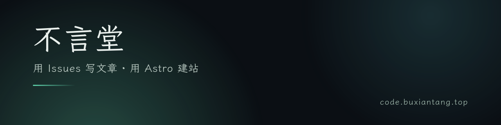
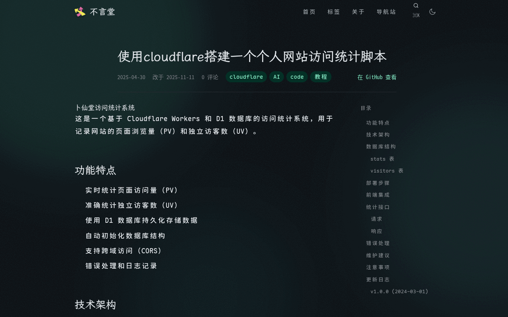
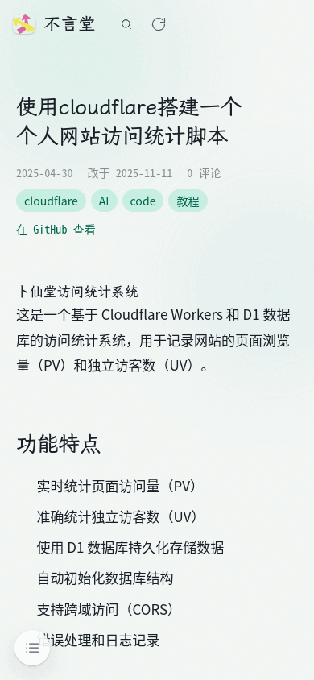

<p align="center">
  
</p>

# 不言堂 · Astro issue 博客模板

用 GitHub Issues 写文章，Astro 7 静态构建，零前端运行时框架。

[](https://github.com/tiengming/tiengming.github.io/actions/workflows/blog.yml)
[](https://astro.build)
[](https://nodejs.org)
[](./LICENSE)

**[🌐 在线演示](https://code.buxiantang.top)** · **[🚀 Use this template](https://github.com/tiengming/tiengming.github.io/generate)** · **[🎨 设计说明](DESIGN.md)**

<p align="center">
  
  
</p>
<p align="center">
  
</p>

## 特性

- **Issue 即文章**：新建 issue 就是发文，标题即标题，标签即分类，关掉即下架。
- **零前端框架**：Astro 7 静态输出，页面不加载任何 UI 框架，交互靠几百行原生 TS。
- **中文搜索**：Pagefind 建索引，⌘K 全文搜索支持中文分词，零后端。
- **评论复用**：utterances 直接复用文章 issue 的评论串，不需要额外数据库。
- **完整输出**：RSS 全文、站点地图、结构化数据、明暗/跟随系统三态主题。
- **旧站兼容**：`legacy/` 自动为旧 Gmeek 链接生成重定向桩，迁移不掉链。

---

## 一、三步部署你自己的博客

1. **用本仓库做模板**：点击绿色 **Use this template** → 新建 `你的用户名.github.io`（或任意名字的仓库）。
2. **改唯一配置文件** [`src/config/site.ts`](src/config/site.ts)：站名、域名、导航、评论仓、统计开关……全部集中于此。
   - 自定义域名：改 `site.url`，替换 `public/CNAME` 内容；不用域名就删掉 `public/CNAME` 并把 `site.url` 设为 `https://用户名.github.io`，同时更新 [`astro.config.mjs`](astro.config.mjs) 的 `site`。
3. **开启 Pages**：仓库 Settings → Pages → Source 选 **GitHub Actions**。然后在 Issues 新建一篇带任意标签的 issue——首次构建会自动跑起来。

装评论前还需一步：到 [utterances.app](https://utterances.app) 点 install 授权你的博客仓库（评论区即文章 issue 的评论串，无需额外数据库）。

## 二、用 issue 写文章

- **发布**：新建 issue 即发文。标题=文章标题，正文=Markdown 正文（表格/代码块/任务列表直接可用，图片直接粘贴上传）。
- **标签即分类**：issue 的 labels 就是文章标签与 `/tags/` 页入口。
- **关于页**：给某一篇 issue 打 `about` 标签，它就会渲染成 `/about/`（改标签名见下）。
- **下架**：close issue 即从站点移除（正文仍在 git 历史里）；重新 open 即恢复。
- **改 about 标签名**：改 `site.ts` 的 `issues.aboutLabel` 后，同步修改 [.github/workflows/blog.yml](.github/workflows/blog.yml) 里 `sync-issues` 的 `--about-label` 参数（两处需一致）。
- **排除标签**：`issues.excludeLabels` 中的标签文章不进列表。
- 文章 URL 恒为 `/p/{issue 编号}/`，改标题不改链接。

## 三、模块配置速查（`src/config/site.ts`）

| 模块 | 字段 | 作用 |
|---|---|---|
| `site` | `url / title / subtitle / description / lang` | 站点元信息（SEO/RSS 同源） |
| `author` | `name / avatar / email / bio` | 作者信息（结构化数据同源） |
| `nav` | `label / href` 数组 | 顶栏导航，http(s) 开头自动外链新窗 |
| `footer` | `text / links` | 页脚文案与链接 |
| `issues` | `aboutLabel / excludeLabels` | issue → 页面的映射规则 |
| `features.comments` | `provider / repo` | `utterances`（填仓库名）或 `off` |
| `features.search` | `true/false` | ⌘K 搜索与索引构建 |
| `features.counter` | `vercount / off` | 页脚访问计数 |
| `features.analytics` | `clarity: id` | Microsoft Clarity（留空即不注入） |
| `theme` | `defaultMode` | 首访默认主题：`auto / dark / light` |

## 四、自定义外观

- **改色**：[`src/styles/tokens.css`](src/styles/tokens.css) 是全部令牌（OKLCH 色板、三层阴影、动效标尺、字阶），只改变量不动组件。设计决策与理由记录在 [DESIGN.md](DESIGN.md)。
- **改极光**：`src/styles/aurora.css`（斑数/漂移/透明度，移动端已自动降为两斑）。
- **改字体**：展示字在 `tokens.css` 的 `--ft-display`（默认霞鹜文楷，按 unicode-range 分包只在用到时下载）；正文走系统 CJK 栈，不加载 webfont。
- **加页面**：在 `src/pages/` 加 `.astro` 文件即可，布局组件在 `src/layouts/`，卡片/分页/目录等在 `src/components/`。

## 本地开发

```bash
npm install
npm run dev        # 开发服务器（内容来自 content/，先跑一次 npm run sync 或直接构建过一次）
npm run sync       # 从 GitHub 拉取 issues 刷新 content/（公共仓库无需 token）
npm run build      # 构建 + 图片懒加载注入 + 旧链接重定向 + 搜索索引
npm test           # 同步/重定向/懒加载脚本的单元测试
```

> 需要 Node **>= 22.22**（Astro 7 的要求）。

## 从 Gmeek 迁移而来？

本仓库自身就是从 Gmeek 迁移的：`legacy/` 目录保存旧 URL 映射，构建时自动在旧路径生成重定向桩（`post/拼音.html → /p/{issue}/` 等 48 条）。新模板用户可整目录删除 `legacy/`，并在 `scripts/build-post.mjs` 里去掉 `legacyRedirects` 一行。

## 结构

```
src/
├── config/site.ts      ★ 唯一需要改的配置
content/                issue 镜像（CI 自动提交，勿手改）
├── layouts/            页面骨架 / 文章布局
├── components/         头部、卡片、目录、评论、命令面板……
├── pages/              路由：/ 、/p/{n}、/tags、/about、/page/{n}
├── scripts/            前端小岛：倾斜/渐显/灯箱
└── styles/             令牌 → 基线 → 极光 → 动效 → 排版
scripts/                构建脚本：issue 同步、懒加载、重定向（含单测）
```

## 许可

[MIT](./LICENSE)。字体：[霞鹜文楷](https://github.com/lxgw/LxgwWenKai)（OFL）。设计系统与决策记录见 [DESIGN.md](DESIGN.md)。
